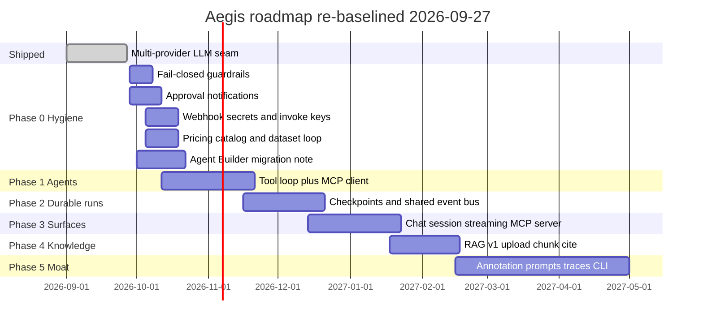

# Aegis — Future Plan

> **Vision:** The self-hosted, model-neutral workbench that runs the full loop — **Build → Guard → Grade → Operate** — on one canvas.
>
> **Re-baselined:** 2026-09-27, from [`docs/competitive-analysis-2026-09-27.md`](docs/competitive-analysis-2026-09-27.md) checked against the current tree. This file is the sequencing source of truth. `docs/ROADMAP.md` is the older parity list and still describes several gaps that have since shipped (LLM-judge evals, regression experiments, OTel export, online sampling).

---

## 1. North star, restated against the market

The August split — visual builders that cannot see inside an LLM, and AgentOps tools that cannot author a graph — has collapsed. n8n shipped first-class Agents on 2026-09-25 (reasoning loop, tools, knowledge, memory, channels, approvals). LangSmith added Fleet (a no-code builder) and Deployment (durable runtime). OpenAI is shutting Agent Builder and its hosted Evals product on **2026-11-30**. Acquirers bought distribution, observability, integrations, and eval talent. Nobody bought a canvas.

That validates the thesis and raises the entry ticket. A canvas plus basic runs no longer differentiates. What still does, and what the suites structurally struggle to offer together:

1. **Model neutrality.** Gemini native via `google-genai`; OpenAI, Anthropic, Fireworks, OpenRouter, Featherless, and Vercel AI Gateway via LiteLLM, with per-node credentials. Model vendors are exiting neutral tooling (OpenAI's shutdown, Anthropic's Humanloop acqui-hire).
2. **Self-hosted trust layer on the canvas.** Datasets, regression experiments, guardrail policies (including Presidio when enabled), nested span waterfalls, failure clusters, and quality alerts ship in this repo. Dify has no eval framework. n8n meters metric evals. Sim is a builder with a thin trust story.
3. **A deterministic graph.** Trigger → … → End, validated before save or compile. The market's enterprise pattern (Salesforce Agent Script, Copilot Studio) is the same shape: a deterministic skeleton with agentic judgment at specific nodes. Aegis is already built that way. The judgment nodes are still single-shot LLM calls.

**Positioning.** Describe Aegis as the self-hosted LangSmith that also authors the workflow. The n8n comparison is an integration-count fight (500+ connectors) that MCP is meant to avoid.

**The loss condition.** Staying a build tool whose publish story ends at a webhook. Every product that monetizes ships a consumption surface: hosted chat, a widget, session memory, token streaming, and a real MCP server. OpenAI killed the hosted-workflow backend; n8n, Sim, Dify, and Relevance invested in surfaces.

**The window.** Agent Builder users must rebuild before 2026-11-30. Its node set (Start, Agent, File Search, Guardrails, MCP, If/else, While, Human approval, Transform, Set state) maps closely onto Aegis, including the two features the obvious destinations lack together: native guardrail nodes and inline graders. The pitch is incomplete until an MCP client exists. Ship a migration note before the deadline, and say plainly which nodes wait on later phases.

---

## 2. Scorecard (verified in tree, 2026-09-27)

| Dimension | In the tree today | What the market now expects | Priority |
| :--- | :--- | :--- | :--- |
| **Workflow canvas** | React Flow, 30 node types in `node_registry.py` (routers, code, iteration with sequential and parallel map, sub-workflows, HITL, error-branch routing honored in `context_wrapper.py`). Reviewable assist: generate, suggest, explain-run, edit, compare, schema (`app/api/assist.py`). | Conditional-until loops (Dify Loop, Agent Builder While). Copilots that draft eval coverage, which n8n InstanceAI now offers. Realtime multiplayer (Sim) is a later concern. | Polish is P2. Eval-suite assist is a moat flourish (Phase 5). |
| **What "agent" means** | `agent` compiles to one ADK `Agent` with an instruction and `output_schema=str`. No `tools=` parameter. `google_search` is attached only to the Google search tool node (`compiler.py`). | A reasoning loop that picks tools. Universal across n8n Agents, Langflow, Flowise V2, Dify, Sim, Make, Relevance, Zapier. | **P0.** Single highest-leverage gap. |
| **LLM providers** | `llm_providers/registry.py`: Gemini, OpenAI, Anthropic, Fireworks, OpenRouter, Featherless, Vercel AI Gateway. | Bedrock, Azure OpenAI, and Ollama (the local-model answer Langflow, Sim, and Flowise use). A multi-model experiment matrix. | Leftovers. Ollama is the one that changes a demo. Matrix is Phase 5. |
| **MCP** | Deploy sheet emits a static tool descriptor (`deploy_descriptor.py`) plus `/v1/workflows/{id}/invoke`. Nothing speaks the protocol. | Client and server. n8n, Langflow, Dify, Sim, Flowise all do both. | **P0.** Client ships with the tool loop. Server ships with the chat surface. |
| **Chat and sessions** | `WorkflowRun.session_id` groups traces. The executor opens a fresh ADK session on every run (`session_id=uuid4()` in `executor.py`), so turn N never sees turns 1..N-1. Deploy "Embed" iframes the invoke URL (`DeploySheet.tsx`). | Hosted chat page, widget, share link, and channel triggers (Slack, Telegram). | **P0** surface. |
| **Streaming** | SSE carries node lifecycle events (`node_completed` and siblings). `/v1/invoke` is request/response. | Token deltas to the caller. | **P0**, same phase as chat. |
| **Integrations** | Slack, Discord, email, Postgres (`integrations.py`), plus an HTTP tool and search via Google, Exa, and DuckDuckGo. | Hundreds of app triggers. MCP client is the breadth strategy. A marketplace is out of scope. | Follows MCP client. |
| **Runtime** | `RUN_EXECUTION_MODE=inline` (default) or `worker` (`worker.py`). SSE and approvals live in the in-memory `_RunEventBroker` and `approval_service.py` (`asyncio.wait_for`). A crash loses the run. One cron row per workflow (`workflow_schedules.workflow_id` is unique). | Durable checkpoint/resume, and a broker any API pod can serve. Temporal Agent Harness and Hatchet make this an adoption choice; Postgres checkpoints get most of the value first. | **P0**, immediately after the tool loop. |
| **RAG** | `knowledge_documents` stores a whole document plus an optional embedding. `kb_retrieve` is retrieval over that text. `pgvector` is optional. | Upload, parse, chunk, rerank, citations, and at least one external store. Dify's Knowledge Pipeline and Sim's connectors are the reference. | **P1** this half. Paste-text RAG fails a demo. |
| **Evaluation** | Datasets with JSON bulk import, single-run add (`POST /api/datasets/{id}/add-run/{run_id}`), and bulk capture of recent, failed, or low-eval runs (`POST /api/datasets/{id}/capture`, wired in `ExperimentsPanel.tsx`). Experiments: `batch` and `regression` (`experiments.py`). LLM-judge plus six deterministic scorers (exact, substring, regex, JSON schema, numeric, embedding). RAG triad metrics. Rubric preview. Online sampler in `executor.py`, **default off** (`online_eval_sample_rate = 0`). | Annotation queues, CSV import, adding the run you are looking at, promoting a failure cluster, trace-pattern analytics (LangSmith Insights), prompt objects with versions. The sampler should default on at a low rate. | Moat work. The engine is ahead of other builders. The closed loop is behind LangSmith, Braintrust, and Opik. |
| **Guardrails** | Rules, Presidio (flagged), injection classifier, moderation, structured-output repair, reusable policies, templates, playground, workflow-level ADK plugin. Missing judge key **passes** with `severity="warn"` (`guardrail.py`). | Fail closed in production. Policies on tool calls (arguments, frequency, data classes), which is where Cisco AI Defense and AgentCore Policy are pushing the category. | Fail-closed is a near-term fix. Action-layer policy is Phase 5. |
| **Observability** | Nested `RunSpan` waterfall, per-call tokens, hardcoded price families in `token_tracker.py` (Gemini, OpenAI, Anthropic; other routed models price as unknown), p50/95/99, failure clusters, sessions, anomaly and regression alerts via webhook (`alerts.py`), outbound OTLP (`tracing.py`, off unless `otel_enabled`). Inbound path is bespoke JSON at `POST /v1/ingest/runs` (`platform.py`: "OTLP arrives later"). | Trace query, session replay, inbound OTLP, a versioned prompt registry. | Export is done. Query and inbound OTLP are Phase 5. |
| **HITL** | Approval gate with `approval_timeout_seconds`. Wait is an in-process event. No assignee, no Slack/email/webhook when a run parks. | Per-tool and cost-based approvals (Relevance), an inbox (LangSmith Fleet), a notification so the wait is visible. | Notifications are near-term. Richer routing follows durable waits. |
| **Code node** | Subprocess sandbox, 4,000 characters, 5 seconds, imports forbidden (`code_sandbox.py`). | JS and Python task runners (n8n), remote sandboxes (Sim on E2B). | Raise limits when it blocks a design. Remote sandbox is P2. |
| **Governance** | Optional `X-Aegis-API-Key`, viewer vs editor. Fernet when `APP_ENCRYPTION_KEY` is set. Trigger URLs authenticate with that same account key (`deploy_descriptor.py` curl snippet). | Workspaces, RBAC, SSO, dev/staging/prod. Commercial tools paywall this. | **Deferred** until a buyer requires it. Do the self-host slice: per-webhook signing secrets and scoped invoke keys. |

### Where the 2026-09-27 report and the tree diverge

The report is the right priority stack. These details are newer or more precise than its wording, and the phases below follow the tree:

- Cost accounting is a multi-family table in `token_tracker.py`, covering Gemini, OpenAI, and Anthropic substrings. Fireworks, Featherless, and many OpenRouter ids still return no price. The fix is a maintained catalog or LiteLLM's cost map, applied to every routed provider.
- Dataset recycling is further along than the report says. `POST /api/datasets/{id}/import` accepts a JSON list. `POST /api/datasets/{id}/capture` copies recent, failed, or low-eval runs into a dataset, deduped by `source_run`, and `ExperimentsPanel.tsx` calls it. `POST /api/datasets/{id}/add-run/{run_id}` copies one run, and `addRunToDataset` in `frontend/src/lib/api.ts` has no caller, so Run Detail cannot do it. There is no CSV import and no action that promotes one failure cluster (clusters group by error signature; capture filters on status and eval score). Feedback (`app/api/feedback.py`) stores thumbs and a comment and does not write dataset rows, despite the module docstring.
- Regression gating exists as experiment `kind: "regression"` with `max_eval_drop`. What is missing is a CLI and a GitHub Action, so the gate is an API call.
- Error branches are live. `context_wrapper.py` routes a failed node along its error edge, and the executor records that as a route. A conditional-until loop does not exist; iteration is map-over-list, sequential or parallel (`node_handlers.py`).
- Outbound OTel is implemented and disabled by default. Inbound OTLP is the open half.

### What to protect while chasing parity

- Eval framework included with the product, plus a regression experiment. n8n meters metric evals; Relevance gates them at Enterprise; Dify has none.
- The guardrail stack on a canvas. Text I/O policy is ahead of other builders. Do not let the fail-open judge path undercut it.
- Observability fused to authoring: waterfall, clusters, alerts, and the assist rail that proposes a reviewable graph diff (`AssistRail.tsx`) instead of silently rewriting the canvas.
- Self-hosted, model-neutral, DAG-validated execution.

---

## 3. Strategic calls

These are decisions, not a backlog.

- **Agent tool-calling and the MCP client are one feature.** ADK already accepts `tools=[...]`. The work is a per-node `tools` field, an ADK `FunctionTool` bridge over built-in tool nodes and registered MCP servers (stdio and streamable HTTP), loop bounds (max iterations, token budget) wired through the existing per-node timeout, and a span per tool call so the waterfall shows the loop. Per-tool approval policy hangs off the same bridge.
- **MCP is the integration strategy.** One client node reaches GitHub, Linear, Notion, Sentry, and vendor MCP surfaces (Zapier MCP, Composio) without a connector catalog. Do not build a plugin marketplace.
- **Durable execution starts as Postgres, with an explicit fork later.** The executor is already a node-at-a-time state machine. A `run_checkpoints` row (run, node, output, next frontier) plus moving `_RunEventBroker` to Postgres `LISTEN/NOTIFY` or Redis pub/sub lets any process serve `/stream` and `/approve`, and lets a crashed run resume. That is the prerequisite for honest HITL. Adopting Temporal Agent Harness or Hatchet is a later fork once agent loops and multi-minute waits are real, and it should be decided before worker mode is treated as production.
- **Enterprise tenancy waits.** Organizations, RBAC, SAML/OIDC, and dev/staging/prod promotion are what CrewAI, Agentforce, and Relevance sell. Ship the self-host minimum: scoped invoke keys and per-deployment webhook secrets. Revisit when a procurement conversation requires it.
- **Do not lead with Bedrock, Azure, or a provider matrix.** They are real leftovers on a shipped seam. They do not change whether a prospect can call Aegis an agent platform.
- **Copilot work proposes eval coverage.** Assist already drafts structure. The differentiated follow-on is an assist action that drafts a golden dataset and a metric set from the graph's node types, in the spirit of n8n InstanceAI, with the same reviewable-diff posture.

---

## 4. Phased roadmap

Dates are planning anchors, not commitments. Phase 0's migration note is time-boxed by the 2026-11-30 Agent Builder shutdown even if other Phase 0 items slip.

### Already shipped (do not re-plan)

Multi-provider seam (`app/services/llm_providers/`, PRs #51 and #52): Gemini native, six LiteLLM providers, per-node provider/model/credential, inspector picker, capability gate on missing keys. Iteration (map, sequential and parallel), error-branch routing, assist rail, datasets, regression experiments, outbound OTel, online-eval hook, failure clusters, guardrail policies.

Still open on that seam, and explicitly not Phase 1: Ollama, Bedrock, Azure OpenAI, and a multi-model matrix inside Experiments.

### Phase 0 — Trust hygiene (next 2–4 weeks)

Small, compounding, and several of them are safety bugs in features that already ship.

| # | Work | Why it is this small | Touch |
| :--- | :--- | :--- | :--- |
| 1 | **Fail-closed guardrails.** A production-flagged deployment blocks when the judge key is missing. Today's LLM, injection, and moderation checks return `passed=True` with a warning. | The skip paths already exist in `guardrail.py`. | `guardrail.py`, deployment flag, a test that a missing key blocks. |
| 2 | **Approval notifications.** On park, POST to a workflow webhook and optionally Slack or email. Record assignee and escalation timeout on the approval row. | The wait already has a timeout. It is invisible. | `approval_service.py`, alert channel already used by `alerts.py`. |
| 3 | **Per-deployment webhook signing secret and a scoped invoke key.** Trigger and invoke URLs stop authenticating with the account `X-Aegis-API-Key`. | A leaked trigger URL is currently a leaked account key. | `deploy_descriptor.py`, `platform.py`, credential or deployment secret storage. |
| 4 | **Provider-aware prices.** Every id in `PROVIDERS` resolves to a rate or an explicit "unpriced" state. Prefer LiteLLM's cost map if it covers the catalog; otherwise extend `MODEL_PRICES_PER_MTOK` and test the families that currently return `None`. | Wrong costs mislead triage now that non-Gemini traffic is real. | `token_tracker.py`. |
| 5 | **Finish the dataset loop.** CSV import. A control on Run Detail that calls the existing `add-run` endpoint. "Promote cluster" on the failure-cluster view (capture today filters by status and eval score, from the experiments panel). Wire negative feedback through the same path. | Bulk capture of failed and low-eval runs already ships in `ExperimentsPanel.tsx`. The holes are CSV, the run you are looking at, a cluster, and thumbs. | `datasets.py`, run detail, observability clusters, `feedback.py`. |
| 6 | **Agent Builder migration note, before 2026-11-30.** Map Start, Agent, File Search, Guardrails, If/else, Human approval, Transform, and Set state onto current nodes. Mark MCP and While as upcoming. Import whatever JSON subset is stable. | Captive audience, and the mapping is mostly honest today. | `docs/`, `workflow_import.py`. |
| 7 | **Online sampling on by default** at a low rate (about 5% of runs that have no inline eval), with a visible control. The hook in `executor.py` already no-ops at rate 0, and it skips runs that already carry eval nodes. | A headline feature currently ships dark. | `config.py` default, observability settings UI. |

### Phase 1 — Agent tool loop and MCP client (the parity push)

Ship as one design.

- Schema: agent node gains `tools` (references to tool nodes and to named MCP servers) plus `maxToolIterations` and a token budget.
- Runtime: `compiler.py` passes ADK tools into the `Agent`. A bridge invokes an Aegis tool node or an MCP tool and returns the result. Each call becomes a span (`trace_plugin.py` already hooks tool callbacks).
- MCP client: `app/services/mcp_client.py` using the Python MCP SDK, transports stdio and streamable HTTP, tool discovery cached on the credential, "Add MCP server" in Settings.
- Inspector: tool multi-select and a discovered-tool list. New node renderer only if the client is its own canvas node; a credential plus a tools field on the agent is enough for v1.
- Bounds reuse per-node timeout and retry. A loop that runs past the budget fails the node and can follow the existing error branch.
- Approval policy can mark individual tools as "require human approval" once Phase 2 makes the wait durable. Until then, record the policy and enforce it in-process.

This is also the integration-breadth move. Native connectors stay at four until a specific one is painful.

### Phase 2 — Durable runs

- Table `run_checkpoints` keyed by run and node: output, status, next frontier. Resume on boot instead of only sweeping orphans to failed.
- Replace the in-memory `_RunEventBroker` with Postgres `LISTEN/NOTIFY` or Redis pub/sub on `run:{id}:events`. Pick `LISTEN/NOTIFY` first if the deployment is already Postgres; add Redis only when fan-out requires it.
- Approvals become rows. Any API process can serve `/stream` and `/approve`. Worker mode (`RUN_EXECUTION_MODE=worker`) stops being a split-brain.
- Frontend SSE listeners reconnect and resume from the last event id.

Leave Celery, ARQ, and Temporal off this phase. Revisit that fork when checkpoints are in production and agent loops plus HITL waits are long enough to justify another control plane.

### Phase 3 — Surfaces people can talk to

- Reuse the ADK session for a deployment-scoped `session_id`, so a chat turn sees prior turns.
- Hosted `/chat/{deployment}` page and a widget snippet that replaces the bare invoke iframe in `DeploySheet.tsx`.
- Token deltas on the existing SSE channel, and a streaming invoke path beside fire-and-poll `/v1/invoke`.
- **Real MCP server** at `/mcp` for a published workflow. The descriptor's name, description, and input schema are the tool definition; the handler calls the same invoke path. External clients (Claude Desktop, Cursor, ChatGPT) can call the workflow as a tool.

Channel triggers (Slack events, email) wait for Phase 5. The chat page is the surface that makes the product shippable.

### Phase 4 — RAG v1

- Upload and parse PDF, DOCX, and Markdown into `knowledge_documents` chunks, with chunk size and overlap.
- One external vector store connector alongside the optional pgvector path.
- Citations on `kb_retrieve` output.
- Hybrid retrieval and reranking are the follow-on, after chunking is real. Whole-document embedding is the credibility problem; rerank is the quality problem.

### Phase 5 — Deepen the moat (pick in this order)

1. **Annotation queue and feedback → dataset.** A queue of runs to label, not only a thumbs control on a single run. Specialists charge for this; other builders do not have it.
2. **Prompt registry and a standalone playground.** Versioned prompt objects that nodes reference. Multi-model playground runs persist as experiments. Today prompts live in node JSON and variant compare sits on the assist compare endpoint.
3. **Trace search, then inbound OTLP.** Filter traces the way the run list already filters runs. Accept OTLP/GenAI semantic conventions on the ingest path so Aegis can observe agents it did not execute. `platform.py` already reserves that step.
4. **Action-layer guardrails.** A policy can reject a tool call whose arguments contain a data class, or cap call frequency. Text I/O policy stays as it is.
5. **Event triggers.** Multiple schedules per workflow (drop the unique constraint), inbound app webhooks with the Phase 0 signing secret, then Slack and IMAP.
6. **`aegis` CLI and a GitHub Action** that calls the existing regression experiment and exits non-zero on `max_eval_drop`. The endpoint is the product; the client is the distribution.
7. **Multi-model experiment matrix** on the LiteLLM seam: one dataset, N provider/model pairs, one comparison. Ollama joins the registry here if a local-model story is part of the same release.
8. **Eval-suite assist.** From the current graph, draft a dataset and a metric preset for review. Uses the assist infrastructure that already exists.

### Deferred until a buyer requires it

- Organizations, workspaces, membership, and roles beyond the current API-key viewer.
- SAML / OIDC (Okta, Entra, Google Workspace).
- Formal dev / staging / prod promotion with environment-scoped credentials.
- Plugin or template marketplace.
- Voice, browser, or computer-use agents.
- Realtime multiplayer editing.
- A remote code sandbox (E2B-class). Until then, the code node stays a bounded subprocess; raising the character and time caps is allowed inside Phase 0 or 1 if a template needs it.
- Full Temporal or Hatchet adoption. Decide at the end of Phase 2 with production checkpoint data, and record the decision in this file.

---

## 5. Module matrix

| Track | Backend | Frontend |
| :--- | :--- | :--- |
| **Phase 0** | `guardrail.py`, `approval_service.py`, `alerts.py`, `deploy_descriptor.py`, `platform.py`, `token_tracker.py`, `datasets.py`, `feedback.py`, `config.py`, `workflow_import.py` | Run detail, observability clusters, Settings, Deploy sheet copy |
| **Tool loop + MCP client** | `compiler.py`, `node_handlers.py`, `node_registry.py`, new `app/services/mcp_client.py`, `trace_plugin.py`, `app/schemas/credential.py` | `src/types/workflow.ts`, `src/lib/node-registry.ts`, `NodeInspector.tsx`, Settings credentials |
| **Durable runs** | `executor.py`, new `app/services/event_bus.py`, `approval_service.py`, `app/db/models.py`, Alembic revision, `docker-compose.yml` if Redis is chosen | `src/app/api/runs/[id]/stream/route.ts`, run-stream hook |
| **Surfaces** | `executor.py` session reuse, `platform.py` streaming and `/mcp`, `deploy_descriptor.py` | New chat route, `DeploySheet.tsx` embed tab |
| **RAG v1** | `knowledge_base.py`, `knowledge_jobs.py`, `embeddings.py`, `models.py` | Knowledge panel inside the workflow data surface |
| **Moat** | `app/api/feedback.py`, new prompt registry service, `observability.py`, `platform.py` ingest, `experiments.py`, `assist.py` | Observability page, a playground page, experiment compare |

---

## 6. Risks to watch

- **LangSmith** is the dangerous competitor to the thesis: Fleet, Deployment, tracing, evals, Insights, and Polly, framework-agnostic. Its weak side is the one Aegis is built for: SaaS-first, closed source, priced per trace. Stay ahead on self-host and on guardrails attached to the graph the user authored.
- **n8n** is closing the trust gap from below (metered evals, InstanceAI proposing an eval suite). The answer is depth of the loop (annotation, regression CLI, action-layer policy), which Phase 5 is for, after the agent loop exists so the comparison is about agents.
- **Substrate absorption.** Bedrock AgentCore now runs framework-agnostic batch and online evals, including on Google ADK. Aegis-on-AgentCore is an interop question, not a reason to stop building the canvas. Revisit if serious deployments start requiring AgentCore Runtime.
- **ADK dependency.** Graph workflows and the tool API are why the compiler is small. They are also a single-vendor runtime dependency underneath a model-neutral product. Keep the provider seam at `llm_providers/` and avoid spreading ADK types past the compiler and executor.

Further research worth doing before Phase 5 packaging decisions: a hands-on bake-off of one guarded workflow on Aegis, Langflow, Sim, Dify, and n8n Agents (trace quality and eval ergonomics), and an explicit hosted-cloud pricing choice if monetization becomes a goal. Every surveyed competitor charges for seats, executions, or hosted inference.
