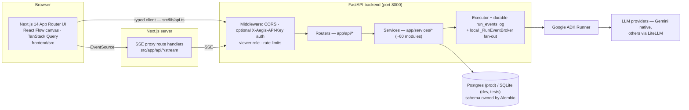
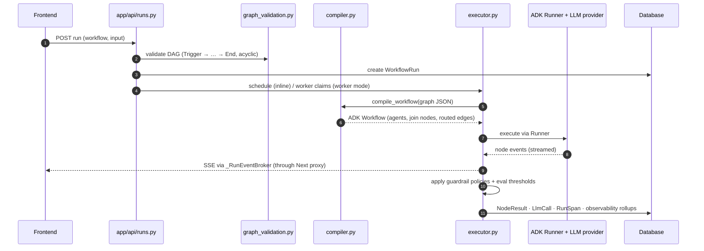
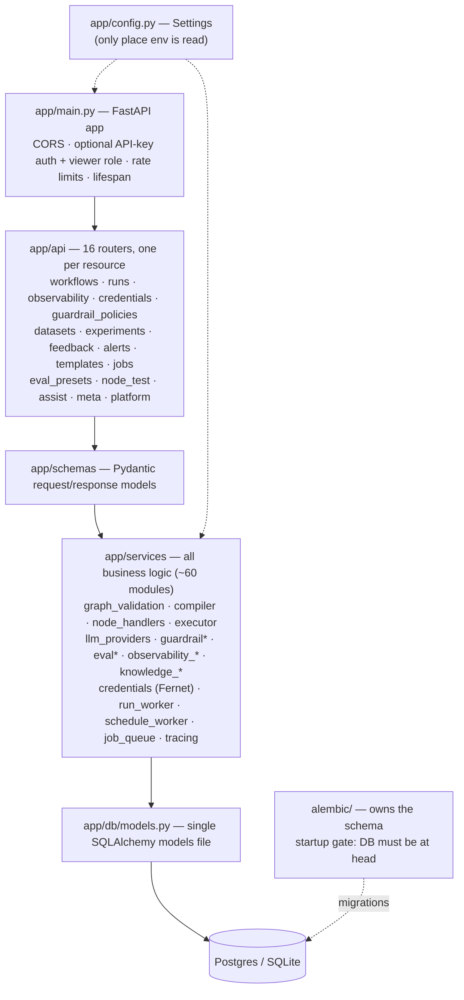
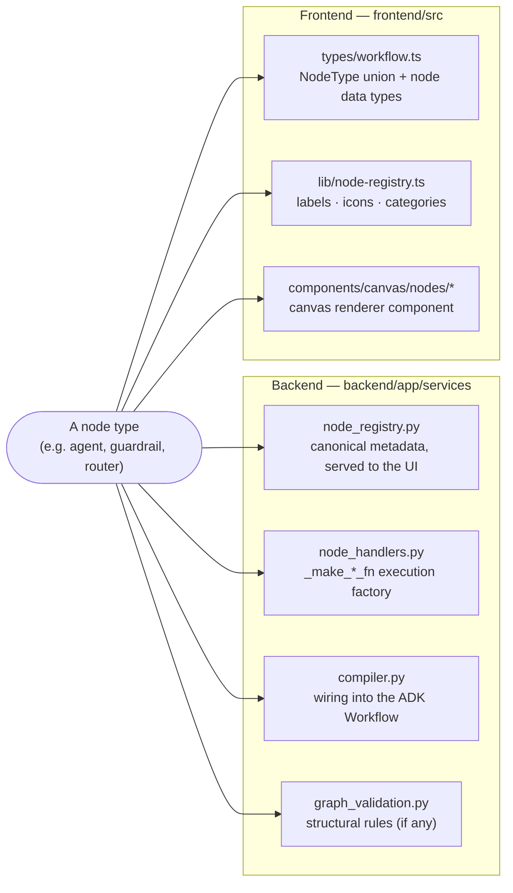
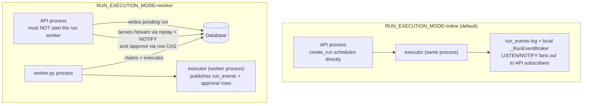
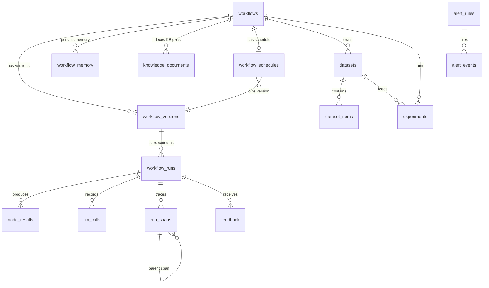

# Aegis — System Architecture

Aegis is a visual agent-workflow workbench: users compose graph workflows (LLM agents, tools,
routers, guardrails, evals) on a React Flow canvas, run them against real inputs via Google ADK
(Gemini natively; OpenAI, Anthropic, and other providers through LiteLLM), and operate them
through an observability/triage surface. Two apps live in one repo:
`backend/` (FastAPI, Python 3.12) and `frontend/` (Next.js 14 App Router, TypeScript).

The diagrams below are Mermaid and render directly on GitHub.

## 1. System overview

The frontend never talks to an LLM provider and never touches the database — every call goes
through the typed client (`frontend/src/lib/api.ts`) to the FastAPI backend. Server-sent events (run stream,
observability stream) are proxied through Next.js route handlers under `src/app/api/*/stream/`
rather than hitting the backend directly.

## 2. Run pipeline (the core loop)

Workflow graphs are stored as JSON (`nodes` + `edges`). A run passes through three services in
order: **validation** (`graph_validation.py`, must be Trigger → … → End, acyclic, no orphan
edges), **compilation** (`compiler.py`, graph JSON → ADK `Workflow`; non-LLM node behaviors come
from `_make_*_fn` factories in `node_handlers.py`), and **execution** (`executor.py`, persists
each emitted event to `run_events` with a per-run seq, fans out to SSE subscribers through the
local `_RunEventBroker`, and wakes remote processes via Postgres LISTEN/NOTIFY; applies guardrail
policies and eval thresholds, and records observability rollups).

Phase 1 agent nodes use `agent_tools.py`: a native ADK `Agent(tools=[FunctionTool, ...])` runs inside a canvas-node wrapper. References point to disconnected builtin Tool declarations or owned/discovered MCP credential tools; declarations remain in stored canvas JSON but are excluded from the executable DAG. The wrapper renders instructions at execution, enforces `maxToolIterations`/`tokenBudget`, preserves node error branches, and stops whole-node retries once tool execution starts. Each invocation becomes a distinct child `RunSpan`, including parallel repeated calls and failures/cancellation. Token usage covers nested grounded Google Search and fails closed when accounting is unavailable.

## 3. Backend layering

Strict layering: routers parse and authorize, schemas shape the payloads, services hold all
business logic, and a single SQLAlchemy models file talks to the database. All settings live in
`app/config.py` (`Settings`) — env vars are never read directly. The app deliberately does **not**
call `Base.metadata.create_all()` on startup; `app/services/startup.py` gates boot on the database
being at Alembic head.

## 4. Node type system (spans both apps)

Adding or changing a node type touches a fixed set of files that must stay in sync across the two
apps. The backend registry (`node_registry.py`) is canonical and is served to the UI.

The registry currently defines 30 node types across six categories:

| Category | Node types |
|---|---|
| `flow` (12) | trigger, end, input_schema, if, switch, filter, human_approval, sub_workflow, router, classifier, join, iteration |
| `data` (8) | transform, set_fields, code, memory_store, memory_retrieve, kb_retrieve, json_parse, delay |
| `llm` (4) | agent, summarizer, translator, extractor |
| `tools` (2) | tool, integration |
| `quality` (2) | evaluation, guardrail |
| `annotate` (2) | note, group (neither is executable) |

`frontend/src/types/workflow.ts` mirrors all 30 in its `NodeType` union. The palette in
`frontend/src/lib/node-registry.ts` intentionally defines only 29 — `group` is a display-only frame
created from the canvas toolbar, not dragged in from the palette.

## 5. LLM provider layer

Every LLM call routes through `app/services/llm_providers/` — the single seam between graph nodes
and model APIs. `registry.py` holds the static provider catalog; `llm_providers/__init__.py`
resolves a node's `provider` / `model` / `credentialId` / `credentialName` (plus the run's
`_user_id`) into a `ProviderModel` and dispatches it.

| Provider id | Label | Invocation path | Key source |
|---|---|---|---|
| `google` | Google Gemini | native `google-genai` (default) | `GOOGLE_API_KEY` env only |
| `openai` | OpenAI | LiteLLM | credential or `OPENAI_API_KEY` |
| `anthropic` | Anthropic | LiteLLM | credential or `ANTHROPIC_API_KEY` |
| `fireworks` | Fireworks AI | LiteLLM | credential or `FIREWORKS_AI_API_KEY` |
| `openrouter` | OpenRouter | LiteLLM (`openrouter/…`) | credential or `OPENROUTER_API_KEY` |
| `featherless` | Featherless AI | LiteLLM (OpenAI-compatible `api_base`) | credential or `FEATHERLESS_API_KEY` |
| `vercel` | Vercel AI Gateway | LiteLLM (OpenAI-compatible `api_base`) | credential or `AI_GATEWAY_API_KEY` |

- `build_adk_model()` returns a bare model string for Gemini and wraps every other provider in
  ADK's `LiteLlm`, so the `Runner` is unchanged.
- `generate_text()` / `generate_structured()` serve direct one-shot paths (router/classifier
  decisions, guardrail LLM checks, deferred evals, and no-tools node previews): Gemini natively,
  others via `litellm.completion` with a `json_object` retry when a provider rejects `json_schema`.
- Tool-enabled agents and their previews use native ADK loops, not the direct one-shot path.
  `maxToolIterations` defaults to 8 tool-call response batches and `tokenBudget` to 8192 reported
  prompt/completion/thinking tokens. Model results that breach a bound cannot invoke further tools.
- Key resolution is per node: a bound credential (Fernet-encrypted, per-user) wins over the
  provider's env var. Google is env-only; every other provider id is also a credential `type`.
- `GET /api/meta/models` exposes the catalog with per-provider `configured` flags, and
  `workflow_capabilities.py` gates run creation on the provider keys a graph actually needs
  instead of always requiring `GOOGLE_API_KEY`.
- An unset or unknown provider falls back to `GEMINI_MODEL`, so existing graphs are unaffected.

Adding a provider mirrors the node-type workflow: extend `registry.py` (backend, canonical), the
credential types in `app/schemas/credential.py` if it takes a bound key, and
`frontend/src/lib/llm-providers.ts` (UI catalog kept in sync by hand).

### MCP client boundary

`mcp_client.py` uses the compatible MCP Python SDK v1 for stdio and Streamable HTTP. A named `mcp` credential stores transport configuration; migration `019_mcp_tool_cache` adds bounded public tool descriptors and discovery timestamp on that credential. Settings and the inspector use owner-scoped discovery APIs. Runtime binds the same owner ID, refreshes live schemas, and scopes initialized sessions/subprocesses to the agent node with deterministic cancellation cleanup. No live sessions are cached globally.

Stdio is explicit administrator opt-in (`MCP_STDIO_ENABLED`), executes argv without a shell, and inherits only minimal SDK environment plus configured values. HTTP requests revalidate/pin DNS, permit private hosts only through exact `MCP_ALLOWED_HOSTS`, and reject redirects/compression. Nested headers/env are encrypted and masked; remote schemas cannot fetch external references and regexes use the bounded linear subset documented in README. This is a client, not an MCP endpoint for published workflows.

## 6. Execution modes and cross-process transport

`RUN_EXECUTION_MODE=inline` (default) executes runs inside the API process. In `worker` mode a
separate `worker.py` process claims and executes runs — the API must not also start the run worker
(split-brain double-claim). Run streams and approval waits are durable, so in worker mode the API
can serve `/stream` and `/approve` for runs the worker is executing: events replay from
`run_events` plus cross-process NOTIFY delivery into the API's broker, and approval decisions are
the `approval_requests` row (waiters poll the row every second; NOTIFY is a wake-up hint). The
schedule worker (cron-style triggers) runs in the API lifespan in both modes.

Human Approval nodes record the wait itself in `approval_requests`: assignee, escalation timeout,
parked/approved/denied/timed_out status, resolution timestamps, and sanitized delivery failures.
The row is the durable wait truth — `wait_for_approval` anchors terminal and escalation deadlines
to `parked_at` (wall clock) and polls the row every second, so a decision committed by any process
resolves a waiter elsewhere, and a restart re-parks the node with a fresh row (deadlines restart;
the interrupted row is resolved `cancelled`). Cancellation records `cancelled`.

On park, the workflow's configured `webhook_url` receives `approval_requested`; optional
`approvalNotifications` bind Slack/email credentials by id/name, never copied integration secrets.
Email requires an SMTP-configured credential (missing SMTP is a delivery failure, not a queued send).
`approvalAssignee` names the reviewer/team. Optional positive-integer `escalationTimeoutSeconds`
sends a single `approval_escalated` reminder while still parked; it never grants approval.
The terminal deadline remains `APPROVAL_TIMEOUT_SECONDS`. Both deadlines start at park; requested
delivery completes before escalation delivery, so a slow bounded transport can delay the reminder.
Notifications cannot grant approval, and failures do not bypass the terminal timeout.

Tool references can require approval before dispatch. Human/tool reviews share one run-wide serialized gate, so parallel nodes do not overwrite the only pending review; queued/parked time does not consume the node's active timeout. Every call has its own approval UUID and argument review. `POST /api/runs/{id}/approve` requires `{ "approval_id": "<displayed-pending-UUID>", "approved": true, "comment": "..." }`. Atomic identity/parked-state checks reject stale or mismatched decisions with HTTP 409 instead of authorizing the next call.

**Durable runs (resume on restart).** Each node execution upserts a `run_checkpoints` row
(`started` on `node_started`, `completed` + output in the same transaction as the `NodeResult`,
`skipped` for authored pins). On boot, `recover_stale_runs` re-queues orphaned
`running`/`awaiting_approval` rows (cancelling parked approval requests so the node re-parks)
while `pending`/`queued` rows stay claimable; `resume_runs_on_boot`/`resume_max_attempts` gate
resume vs. the old fail-all behavior. `compute_resume` derives pinned outputs and the frontier
(`started` ∪ safe-ready nodes — children behind conditional edges only resume if they already
started), and `prune_graph_for_resume` rewires the trigger into the frontier. In inline mode
`resume_orphaned_runs` (lifespan) and a post-run drain in `execute_run` claim the durable
backlog via `FOR UPDATE SKIP LOCKED`; in worker mode the worker poll claims re-queued runs.
Run stream events persist to `run_events` (replay on SSE reconnect via `?after_seq=`), deleted
when the run terminates.

## 7. Data model (key relationships)

A single SQLAlchemy models file (`app/db/models.py`, 22 tables). The core chain is
workflow → version → run → per-node observability records. Standalone tables not shown:
`observability_rollups`, `background_jobs`, `evaluation_presets`, `credentials` (Fernet-encrypted
secrets when `APP_ENCRYPTION_KEY` is set), `guardrail_policies`, `workflow_templates`, `audit_log`.

